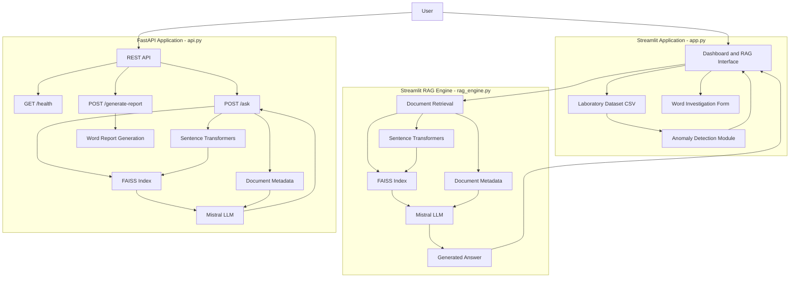

# LabGuard AI 🧪

**Laboratory Data Analysis, Anomaly Detection and AI-Powered Quality Document Assistant**

## Overview

LabGuard AI is a Data Science and Artificial Intelligence portfolio project exploring the application of machine learning and Large Language Models (LLMs) to laboratory quality monitoring.

The application combines laboratory data analysis, Isolation Forest-based anomaly detection, and a Retrieval-Augmented Generation (RAG) assistant for laboratory quality documentation.

It provides both an interactive Streamlit application and a REST API developed with FastAPI.

## Main Features

- **Laboratory Dashboard:** Interactive analysis and visualization of laboratory results using Streamlit.
- **Anomaly Detection:** Identification of statistically unusual laboratory results using Isolation Forest.
- **RAG Document Assistant:** Semantic document retrieval using FAISS and multilingual Sentence Transformers.
- **LLM Integration:** Context-based answer generation using Mistral AI.
- **Investigation Report Generation:** Automatic generation of a prefilled Word investigation form for the illustrative Glucose case (Sample ID 23247).
- **REST API:** FastAPI endpoints for health checks, RAG queries, and Word report generation.

## System Architecture

The following diagram illustrates the main components of LabGuard AI, including the Streamlit application, FastAPI service, anomaly detection module, and RAG document assistant.



**Architecture note:** The Streamlit application uses the shared `rag_engine.py` module. The FastAPI application currently implements its own RAG retrieval and generation functions. Both use the local FAISS index and metadata files. Word report generation is implemented independently in each application.

## Technology Stack

| Category | Technologies |
|---|---|
| Programming Language | Python |
| Data Analysis | Pandas, NumPy |
| Data Visualization | Matplotlib |
| Machine Learning | Scikit-learn, Isolation Forest |
| Frontend | Streamlit |
| Backend / REST API | FastAPI, Uvicorn |
| Vector Search | FAISS |
| Embeddings | Sentence Transformers |
| LLM | Mistral AI |
| RAG Framework | LangChain Mistral integration |
| Word Document Generation | python-docx |

## Project Structure

```text
LabGuard-AI/
│
├── app.py
├── api.py
├── rag_engine.py
├── requirements.txt
├── README.md
├── .gitignore
│
├── pages/
│   └── 02_Anomaly_Detection.py
│
├── Anomaly_detection.ipynb
├── RAG_LLM.ipynb
│
├── FICHE-LAB-ANOM-001.docx
├── FICHE_Cas_Glucose.docx
├── Procedure_anomalies_detection.docx
│
└── LabGuard_AI_Generation_Per_Question.png
    LabGuard_AI_RAGAS_Results.png
    LabGuard_Correlation_Matrix_16_Tests.png
    LabGuard_Selected_Tests_Histograms.png
```

**Local files not included in the repository:**
- Laboratory datasets (CSV files).
- `.env` containing the Mistral API key.
- `rag/faiss_index.bin` and `rag/metadata.pkl`.
- Generated temporary files and Jupyter checkpoints.

## Installation and Local Setup

### 1. Clone the repository

```bash
git clone https://github.com/YOUR_USERNAME/LabGuard-AI.git
cd LabGuard-AI
```

### 2. Install dependencies

```bash
pip install -r requirements.txt
```

### 3. Configure the Mistral API key

Create a `.env` file in the project root directory:

```text
MISTRAL_API_KEY=your_api_key_here
```

Do not commit or share this file.

### 4. Prepare local data and RAG resources

Obtain the laboratory dataset from its original source and place the required cleaned CSV file in the project root:

```text
Laboratory_Data_Final_Merged_Clean.csv
```

Prepare the RAG resources using the document indexing workflow provided in the project:

```text
rag/
├── faiss_index.bin
└── metadata.pkl
```

These files are generated or maintained locally and are not included in the public GitHub repository.

## Running the Streamlit Application

```bash
streamlit run app.py
```

The application provides:
- Laboratory data dashboard.
- RAG document assistant.
- Glucose investigation Word report generation.

The additional anomaly detection page is available through the Streamlit navigation.

## Running the FastAPI Application

Start the API:

```bash
uvicorn api:app --reload
```

Open the interactive API documentation:

http://127.0.0.1:8000/docs

### API Endpoints

| Method | Endpoint | Description |
|---|---|---|
| GET | `/health` | API health check |
| POST | `/ask` | RAG document assistant |
| POST | `/generate-report` | Generate the Glucose Sample ID 23247 Word report |

## RAG Evaluation

The RAG assistant was evaluated using RAGAS and additional retrieval metrics.

The evaluation explored:
- Context precision.
- Context recall.
- Faithfulness.
- Answer relevancy.
- Answer correctness.
- Retrieval precision, recall and Mean Reciprocal Rank (MRR).

Evaluation results and visualizations are presented in the project images and RAG notebook.

## Dataset and Licensing

This project uses the **Multi-Center Clinical Laboratory Dataset (MCLD)**, published on Mendeley Data.

- **Source:** Mendeley Data
- **DOI:** https://doi.org/10.17632/xxkd3kjfdd.1
- **License:** Creative Commons Attribution-NonCommercial 3.0 Unported (CC BY-NC 3.0)
- **License information:** https://creativecommons.org/licenses/by-nc/3.0/

The dataset is not included in this repository. Users must obtain it from its original source and comply with its attribution and non-commercial use requirements.

## Important Disclaimer

LabGuard AI is an educational and portfolio project.

Statistical anomalies identified by the system do not automatically represent confirmed laboratory errors, analytical nonconformities, or clinical abnormalities.

The Glucose Sample ID 23247 investigation form is an illustrative case based on dataset information. It is not a real laboratory nonconformity record.

The application is not intended for clinical decision-making or autonomous correction of laboratory results.

## Project Status

**Portfolio development – core components implemented.**

The project includes laboratory data analysis, anomaly detection, a RAG document assistant, Word investigation report generation, and a FastAPI REST API.

The applications are developed and tested locally. Public cloud deployment is not included in the current project scope.